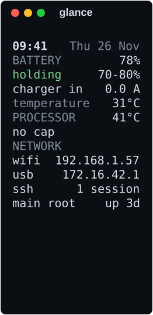
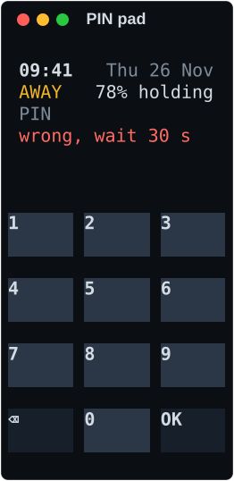
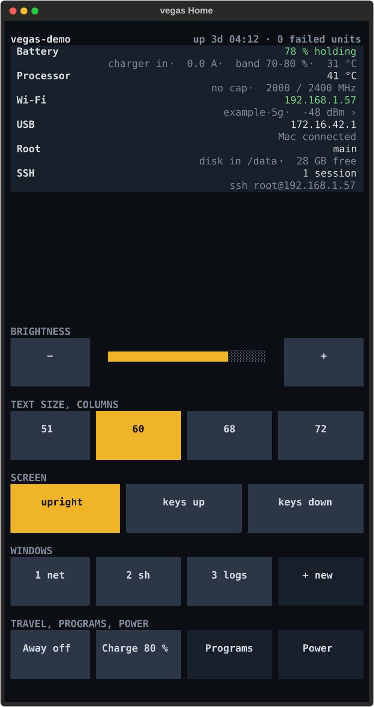
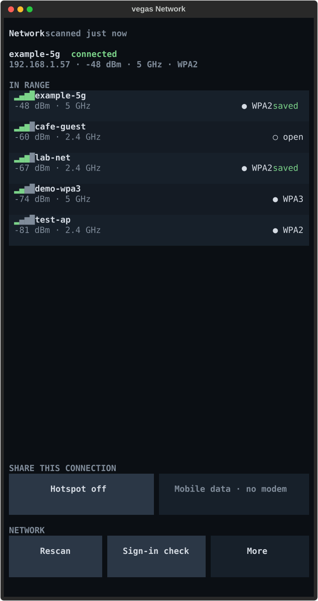

# gpower26-cluster-pub

Tooling that turns Motorola moto g power (2026) phones (XT2617V, product `vegas`, MediaTek MT6835) into a small phone
cluster, driven from a Mac over adb and fastboot. It is mostly bash, plus two terminal dashboards and a Debian image
that boots on the phone.

This is the public companion of a private working repo. It is a scrubbed snapshot: it holds the scripts, the Linux
port and the docs, and no firmware, no vendor files and no phone identifiers. Maintainer: Yifei Ding.

**Read [DISCLAIMER.md](DISCLAIMER.md) first.** Most code paths here flash partitions. A wrong image can brick a phone,
and real hardware is the only real test.

## What works today

Everything below was verified on the maintainer's own phones. Each doc marks its claims as verified or unverified.

- **End state D ("locked-clean"), the default.** The bootloader stays locked and Android Verified Boot stays green. A
  patched retail `lk` reports `carrier=retus`, so the Tracfone activation and preloads are skipped. The SIM-unlock
  modem is optional. The phone is not rooted in daily use: temporary root (DFRoot plus KernelSU) is used once for
  setup. Charging is capped at 80% by Moto Battery protection.
- **Downgrade and upgrade.** A phone on a build newer than `W1WEOS36.48-22-3-3-4-2` goes down to the base build and
  back up to `-4-2`, then through the D route.
- **End state E (dual boot).** The bootloader is unlocked. The phone boots normal, unrooted Android by default and
  boots Debian trixie when you tap Vol-up right after the warning screen. Debian lives in a logical partition `linux`
  inside `super`. SSH over USB, the fuel gauge, the charge and thermal guards and Wi-Fi are verified on one phone.
  The touch UI (sway, foot and an on-screen keyboard) passes its VM tests; its tests on the phone are open issues.
- **End state A (legacy).** Unlocked bootloader and permanent KernelSU root. No phone runs it now. Its scripts and
  `ksu-modules/` are kept for reference, and the way back from D to A is unverified.

## Screenshots

The touch UI on the Debian side (end state E). These are rendered from the UI code with made-up data on a Mac
([`tests/ui-seed/tools/render_readme_svgs.py`](tests/ui-seed/tools/render_readme_svgs.py)); they are not photos of
the phone.

| Glance | Away PIN pad | Home | Network |
| --- | --- | --- | --- |
|  |  |  |  |
| Shown on wake: battery, charge band, addresses, SSH. | Away mode: a wrong PIN starts a wait. | Status, brightness, text size, rotation, windows. | Wi-Fi in range, hotspot, rescan. |

Landscape: [glance](docs/ui/img/glance-landscape.svg) and [PIN pad](docs/ui/img/pin-pad-landscape.svg). The
landscape glance leaves two columns blank on each short edge, for the camera hole.

## What we want help with

Work is organised in **batches**. A batch is one GitHub issue that holds 1 to 8 related tasks in working order, and
it comes back as one pull request. A batch is sized for one sitting, by a person or by a coding agent. The batches sit
in four milestones:

| Milestone | What it holds |
|---|---|
| M0 repo ready | what must land before anyone else starts |
| M1 start here | needs no phone, and nothing but M0 is in front of it; all of these can run in parallel |
| M2 offline next | needs no phone, waits on other batches |
| M3 phone queue | needs a phone |

The areas: VoIP calls over Wi-Fi (no modem), GPU drawing on the Mali-G57, mobile data over the modem, voice calls and
SMS over the modem, root encryption (LUKS2), testing the touch UI on real hardware, and contributor onboarding and CI.
Every batch is labelled with the hardware it needs, its highest risk and its dependency wave. Most need no phone.

[docs/batches.json](docs/batches.json) lists every batch and task in machine-readable form. Start with
[CONTRIBUTING.md](CONTRIBUTING.md); agents also read [CLAUDE.md](CLAUDE.md).

## What is not in this repo

- Motorola or MediaTek firmware, the patched `lk` images, the SIM-unlock modem image and any vendor file. You get
  those yourself; [tools/locked/README.md](tools/locked/README.md) says what they are and lists their SHA-256 hashes.
- Root tools and app packages: [tools/root-apks/README.md](tools/root-apks/README.md) and
  [tools/apps/README.md](tools/apps/README.md) give the download commands and hashes.
- Anything built: no kernel, boot image or root filesystem is published here, ever. You build from your own phone and
  your own firmware.
- Per-phone records. `devices/`, `logs/`, `backups/` and `linux/work/` are local and gitignored. They hold serial
  numbers, IMEIs and partition dumps, and they must never be committed or pasted into an issue.

## Setup (Mac)

Requirements: macOS with Python 3.10+, `git` and `gh`. No Android SDK is needed. The Linux builds run in two Linux
VMs (the docs use OrbStack: one x86_64 VM for the kernel, one arm64 VM for Debian).

```bash
git clone --recurse-submodules https://github.com/dingyifei/gpower26-cluster-pub
cd gpower26-cluster-pub
git submodule update --init                   # if cloned without --recurse-submodules

python3 -m venv .venv
source .venv/bin/activate
pip install -r requirements-dev.txt           # pytest and Textual
pip install -r vegas-freedom/requirements.txt # capstone + pyasn1, for the lk patch scripts
python -m pytest sidemdm/tools -q             # expect: 12 passed
```

Then fetch the gitignored binaries: [tools/root-apks/](tools/root-apks/README.md) (`route_d.sh` refuses to run
without them), [tools/apps/](tools/apps/README.md) and [tools/locked/](tools/locked/README.md). Verify the locked-route
files with `shasum -a 256 -c SHA256SUMS`.

## Take a phone to end state D

Power a fresh phone on holding Vol-down so it starts in fastboot. Then run one of these:

```bash
.venv/bin/python scripts/bench.py                  # dashboard: pick the phone, press r
scripts/route_d.sh <serial>                        # the same flow in a terminal; --from/--only <stage> to resume
```

Stages: `preflight gate-fastboot flash erase setup gate-android root verify-flash backup clean root-config drop-root
verify sim-test record`. The destructive stages ask you to type a confirmation that names the phone
(`FLASH <serial>`, `ERASE <serial>`). Progress is kept in `logs/<serial>/stages.json`.

`route_d.sh` accepts only build `36.48-22-3-3` (base) or `-4-2`, because the patched `lk` was made from `-4-2`. For a
newer phone: `scripts/downgrade.sh <serial>`, then `scripts/upgrade.sh <serial>`, then `route_d.sh` with
`GATE_BASEBAND_ANY=1`. Details: [docs/community-notes.md](docs/community-notes.md) sections 4A and 4B.

## Dual boot with Debian (end state E)

The route is `scripts/route_e.sh` (it runs `scripts/linux_b.sh`). It unlocks the bootloader, which wipes the phone
once, and it refuses a phone that is not listed in your local `farm-exclude.txt` (copy
`farm-exclude.example.txt`). The runbook is [linux/README.md](linux/README.md) and the research behind it is
[docs/linux-on-vegas.md](docs/linux-on-vegas.md).

## Run the cluster

```bash
.venv/bin/python scripts/farm.py                   # dashboard: battery, charge cap, temperature, RAM, root, end state
.venv/bin/python scripts/farm.py status            # one-shot table
.venv/bin/python scripts/farm.py run wake|park|record|charge-protect|root|reboot [serial ...|all]
```

Single-phone commands are in [docs/phone-sh.md](docs/phone-sh.md).

## Docs

| Doc | What is in it |
|---|---|
| [docs/community-notes.md](docs/community-notes.md) | Digest of the USCardForum threads the flashing routes come from |
| [tools/locked/README.md](tools/locked/README.md) | The route D and downgrade files, hashes, return to A |
| [docs/linux-on-vegas.md](docs/linux-on-vegas.md) | Research on running Linux on the phone, with a verification status per claim |
| [linux/README.md](linux/README.md) | Runbook for the rebuilt kernel, the boot chooser and the Debian image |
| [docs/telephony-on-vegas-debian.md](docs/telephony-on-vegas-debian.md) | Research on the modem under Debian |
| [docs/ui/](docs/ui/) | Touch UI: the implementation spec, the builder's integration notes, where the build differs from the design |
| [docs/research/](docs/research/) | Research reports: GPU, cellular, encryption, LineageOS as a reference |
| [tests/ui-seed/](tests/ui-seed/README.md) | The raw VM test suites of the touch UI |
| [docs/phone-sh.md](docs/phone-sh.md) | `scripts/phone.sh` command reference |
| [docs/ota.md](docs/ota.md) | Turning off OTA updates |
| [docs/bl-feasibility.md](docs/bl-feasibility.md) | Read-only gates that identify a phone and its build |
| [docs/activation-qr.md](docs/activation-qr.md) | QR enrollment for stock and end-state-A phones (sidemdm) |
| [docs/route-a-legacy.md](docs/route-a-legacy.md), [docs/unlock-root-runbook.md](docs/unlock-root-runbook.md), [docs/post-root-procedure.md](docs/post-root-procedure.md) | Legacy end state A |
| [ksu-modules/README.md](ksu-modules/README.md) | KernelSU modules, legacy end state A |

In the docs, "#1" to "#8" are the maintainer's eight phones. The numbers carry no other meaning.

## Licence and credits

MIT for the original code and docs: [LICENSE](LICENSE). A few files derived from wvkbd are GPL-3.0-or-later, and the
two submodules keep their own licences: see [THIRD_PARTY.md](THIRD_PARTY.md).

The flashing routes come from the USCardForum community (topics 546212, 547067 and 548192). The lk patch scripts are
[vegas-freedom](https://github.com/andrewwm/vegas-freedom), and the QR enrollment tool is
[sidemdm](https://github.com/lukeponio/sidemdm). The Linux port builds on the public ports of two sister devices,
credited in [docs/linux-on-vegas.md](docs/linux-on-vegas.md).

Not affiliated with Motorola, Lenovo, MediaTek or Tracfone.
